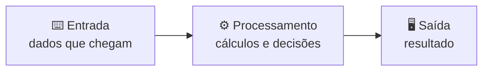
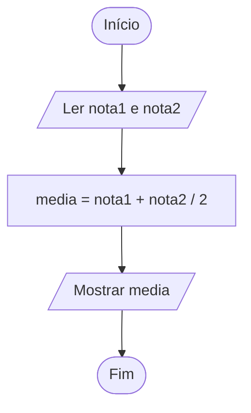

# 01 · O que é um algoritmo

> ⏱️ 15 minutos · Sem código ainda: só aprender a **pensar** como programador.

## Uma receita de bolo

**Algoritmo** é uma sequência de passos, bem definida e com fim, para resolver um problema. Você já segue algoritmos todo dia, mesmo sem perceber:

```
Fazer café:
1. Ferver a água
2. Colocar o pó no filtro
3. Despejar a água sobre o pó
4. Se quiser doce, adoçar
5. Servir
```

Esse algoritmo já tem as três coisas que vão aparecer em **todo** programa:

| | No café | Na programação |
|---|---|---|
| **Sequência** | Passos 1, 2, 3... em ordem | Instruções executadas de cima para baixo |
| **Decisão** | "Se quiser doce" | `if` (condicional) |
| **Repetição** | "Mexer até dissolver" | `for` / `while` (laço) |

## O computador é um ajudante muito literal

Imagine pedir para alguém **que nunca viu uma cozinha** fazer o café. "Ferver a água"... em quê? Quanta água? Até quando?

O computador é assim: ele faz **exatamente** o que você mandar, nem mais, nem menos. Ele não adivinha. Por isso, um bom algoritmo precisa ser:

- **Claro:** cada passo tem um único jeito de ser entendido.
- **Finito:** termina em algum momento.
- **Ordenado:** a ordem dos passos importa. (Servir antes de despejar a água não dá certo!)

## Entrada → processamento → saída

Todo programa segue esse caminho:



Exemplo: **calcular a média de duas notas**.

| Etapa | O que é |
|---|---|
| Entrada | As duas notas |
| Processamento | Somar e dividir por 2 |
| Saída | A média |

> 💡 **Antes de escrever qualquer código, responda: o que entra? o que sai? o que acontece no meio?** Essa pergunta resolve metade dos desafios.

## Pseudocódigo: o "rascunho" do programa

**Pseudocódigo** é escrever o algoritmo em português estruturado, sem se preocupar com as regras de uma linguagem. É o rascunho antes da redação:

```
início
    leia nota1
    leia nota2
    media ← (nota1 + nota2) / 2
    escreva media
fim
```

O `←` significa "recebe": a variável `media` recebe o resultado da conta. Depois, passar isso para C ou Python é quase uma tradução.

> 📚 Em algumas faculdades você vai ver o **Portugol** ou o **VisuAlg**: são "linguagens de pseudocódigo" em português que até rodam no computador.

## Fluxograma: o algoritmo em desenho

Outra forma de representar um algoritmo é com desenhos:



| Forma | Significa |
|---|---|
| Oval | Início ou fim |
| Paralelogramo | Entrada ou saída |
| Retângulo | Processamento (contas) |
| Losango | Decisão (pergunta de sim ou não) |

## Teste de mesa: rodando o programa no papel

O **teste de mesa** é simular o algoritmo à mão, anotando o valor de cada variável. Parece bobo, mas é a ferramenta mais poderosa para achar erros.

Algoritmo: `soma ← 0`, depois, para `i` de 1 até 3, fazer `soma ← soma + i`.

| Passo | i | soma |
|---|---|---|
| início | — | 0 |
| 1 | 1 | 0 + 1 = 1 |
| 2 | 2 | 1 + 2 = 3 |
| 3 | 3 | 3 + 3 = 6 |

Resultado: `6`. Se o seu programa der outro número, o teste de mesa mostra **em que passo** a coisa desandou.

## Como resolver qualquer desafio

1. **Leia o enunciado duas vezes.** Sério.
2. **Responda:** o que entra, o que sai e o que acontece no meio?
3. **Resolva um exemplo à mão**, sem computador.
4. **Escreva em pseudocódigo.**
5. **Traduza para a linguagem.**
6. **Teste** com os exemplos, e com casos estranhos: zero, negativo, números iguais.

## 🧪 Teste rápido

1. Escreva o algoritmo de "atravessar a rua" com pelo menos uma decisão.
2. Em pseudocódigo: leia a idade de uma pessoa e mostre quantos anos ela terá daqui a 10 anos.

---

[⬅️ Lógica](../README.md) · [Próximo: Variáveis e tipos ➡️](02-variaveis-e-tipos.md)
