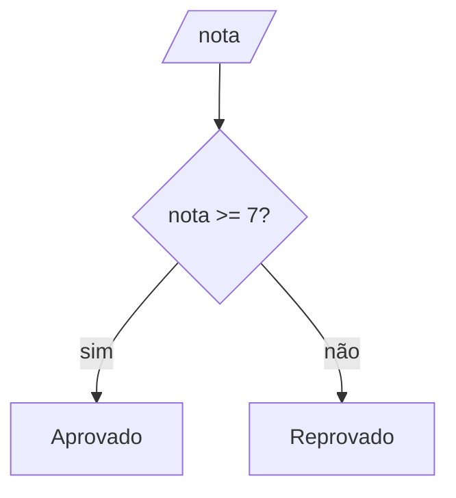

# 04 · Condicionais: tomando decisões

> ⏱️ 20 minutos

Até agora, os programas seguiam sempre o mesmo caminho. Com condicionais, eles passam a **decidir**: "se isso, faça aquilo; senão, faça outra coisa".

## se / senão

```
se nota >= 7 então
    escreva "Aprovado"
senão
    escreva "Reprovado"
fim-se
```



**C**
```c
if (nota >= 7) {
    printf("Aprovado\n");
} else {
    printf("Reprovado\n");
}
```

**Python**
```python
if nota >= 7:
    print("Aprovado")
else:
    print("Reprovado")
```

> 💡 No Python, o que define o que está "dentro" do `if` é a **indentação** (os espaços no começo da linha). Em C, são as **chaves** `{ }`. Mesmo em C, indente sempre: o código fica muito mais fácil de ler.

## Mais de dois caminhos: senão se

```
se media >= 7 então
    escreva "Aprovado"
senão se media >= 5 então
    escreva "Recuperacao"
senão
    escreva "Reprovado"
fim-se
```

| C | Python |
|---|---|
| `else if (media >= 5)` | `elif media >= 5:` |

O computador testa **de cima para baixo** e para no **primeiro** verdadeiro. Por isso a **ordem importa**:

```
se media >= 5 então      ❌ uma média 9 entra aqui primeiro!
    escreva "Recuperacao"
senão se media >= 7 então
    escreva "Aprovado"   (nunca chega aqui)
```

> 💡 Regra prática: comece pelo caso **mais restrito** (o maior valor, a condição mais específica).

## Condições compostas

Use `E` / `OU` para juntar testes:

```python
if idade >= 16 and idade < 18:
    print("Voto opcional")
```

```c
if (idade >= 16 && idade < 18) {
    printf("Voto opcional\n");
}
```

## Condicionais dentro de condicionais (aninhadas)

```python
if tem_ingresso:
    if idade >= 14:
        print("Pode entrar")
    else:
        print("Precisa de um responsável")
else:
    print("Compre um ingresso")
```

Funciona, mas cuidado: muitos níveis viram uma "escadinha" difícil de ler. Muitas vezes dá para simplificar com `E` / `OU`.

## Escolha entre muitos valores fixos

Quando você compara a **mesma variável** com vários valores exatos, existe o `switch` (C) e o `match` (Python 3.10+):

```c
switch (opcao) {
    case 1: printf("Novo jogo\n"); break;
    case 2: printf("Continuar\n"); break;
    default: printf("Opcao invalida\n");
}
```

> ⚠️ Em C, esquecer o `break` faz o programa "cair" no próximo `case` também.

## Erros clássicos

| Erro | Exemplo | O que acontece |
|---|---|---|
| `=` no lugar de `==` | `if (x = 0)` (C) | Guarda 0 em `x` e o teste é sempre falso |
| `;` depois do `if` | `if (x > 0);` (C) | O `if` termina ali, e o bloco seguinte roda **sempre** |
| Esquecer o caso de igualdade | `if (nota > 7)` | Quem tirou exatamente 7 é reprovado |
| Ordem errada no `senão se` | ver acima | Casos nunca alcançados |
| Indentação errada (Python) | linha fora do alinhamento | `IndentationError` ou lógica errada |

## Teste os limites!

Sempre que tiver um `>=` ou `<`, teste o **valor exato do limite** e um a mais e um a menos. Se o corte é 7: teste `6.9`, `7` e `7.1`. É onde a maioria dos erros se esconde.

## 🧪 Teste rápido

1. Escreva em pseudocódigo: leia a temperatura e mostre "Frio" (menor que 15), "Agradável" (de 15 a 25) ou "Calor" (acima de 25).
2. O que este código em C mostra quando `x = 5`? `if (x > 10); printf("Grande\n");`

## 🎯 Pratique

- [01 · Par ou ímpar](../desafios/01-par-ou-impar/)
- [02 · O maior de três](../desafios/02-maior-de-tres/)

---

[⬅️ Operadores](03-operadores.md) · [Próximo: Repetições ➡️](05-repeticoes.md)
