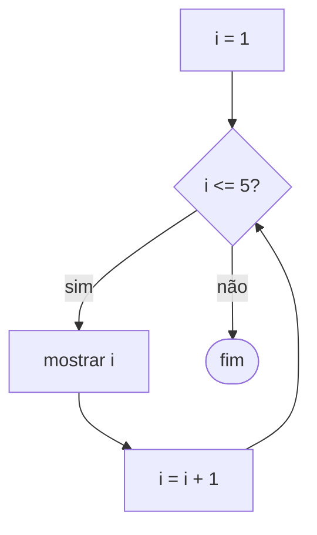

# 05 · Repetições (laços)

> ⏱️ 25 minutos

Imagine mostrar os números de 1 a 1000. Copiar 1000 linhas de `escreva`? Não! Para isso existem os **laços** (ou *loops*): blocos que se repetem.

## enquanto (while)

Repete **enquanto** a condição for verdadeira. Use quando você **não sabe** quantas vezes vai repetir.

```
i ← 1
enquanto i <= 5 faça
    escreva i
    i ← i + 1
fim-enquanto
```



**C**
```c
int i = 1;
while (i <= 5) {
    printf("%d\n", i);
    i++;
}
```

**Python**
```python
i = 1
while i <= 5:
    print(i)
    i += 1
```

### ⚠️ O laço infinito

Se a condição **nunca** ficar falsa, o programa nunca para:

```python
i = 1
while i <= 5:
    print(i)
    # esqueceu o i += 1: i é sempre 1!
```

Se acontecer, aperte `Ctrl + C` no terminal para interromper. Nos nossos desafios, a correção automática para depois de 5 segundos e avisa: "Será um laço infinito?".

## para (for)

Use quando você **sabe** quantas vezes vai repetir. Ele junta tudo numa linha: início, condição e passo.

```
para i de 1 até 5 faça
    escreva i
fim-para
```

**C**
```c
for (int i = 1; i <= 5; i++) {
    printf("%d\n", i);
}
```

O `for` do C tem três partes, separadas por `;`:

| Parte | Exemplo | Quando roda |
|---|---|---|
| Início | `int i = 1` | Uma vez, antes de tudo |
| Condição | `i <= 5` | Antes de cada volta |
| Passo | `i++` | Depois de cada volta |

**Python**
```python
for i in range(1, 6):
    print(i)
```

> ⚠️ No Python, `range(1, 6)` vai de 1 até **5**: o último número **não** entra. `range(5)` vai de 0 a 4.

| Python | Gera |
|---|---|
| `range(5)` | 0, 1, 2, 3, 4 |
| `range(1, 6)` | 1, 2, 3, 4, 5 |
| `range(0, 10, 2)` | 0, 2, 4, 6, 8 |
| `range(5, 0, -1)` | 5, 4, 3, 2, 1 |

## Os dois padrões mais usados

### Contador: "quantos?"

```python
quantidade_pares = 0
for i in range(1, 11):
    if i % 2 == 0:
        quantidade_pares += 1
print(quantidade_pares)   # 5
```

### Acumulador: "quanto deu no total?"

```python
soma = 0
for i in range(1, 6):
    soma += i
print(soma)   # 15
```

> ⚠️ O contador e o acumulador precisam começar com valor (`= 0`) **antes** do laço. Em C, uma variável sem valor inicial guarda "lixo" da memória, e a conta sai errada.

Teste de mesa do acumulador:

| Volta | i | soma |
|---|---|---|
| antes | — | 0 |
| 1 | 1 | 1 |
| 2 | 2 | 3 |
| 3 | 3 | 6 |
| 4 | 4 | 10 |
| 5 | 5 | 15 |

## Lendo vários números com um laço

```python
n = int(input())          # quantos números virão
soma = 0
for _ in range(n):
    numero = int(input())
    soma += numero
print(soma)
```

```c
int n, numero, soma = 0;
scanf("%d", &n);
for (int i = 0; i < n; i++) {
    scanf("%d", &numero);
    soma += numero;
}
printf("%d\n", soma);
```

## faça... enquanto (do-while)

Testa a condição **no final**, então roda pelo menos uma vez. Útil para menus. Existe em C; no Python não há, mas dá para imitar com `while True` e `break`.

```c
int opcao;
do {
    printf("1 - Jogar | 0 - Sair\n");
    scanf("%d", &opcao);
} while (opcao != 0);
```

## break e continue

| Comando | O que faz |
|---|---|
| `break` | Sai do laço na hora |
| `continue` | Pula para a próxima volta |

```python
for i in range(1, 11):
    if i == 5:
        break        # para quando chegar no 5
    print(i)         # mostra 1, 2, 3, 4
```

## Laços dentro de laços

```python
for linha in range(1, 4):
    for coluna in range(1, 4):
        print(linha * coluna, end=" ")
    print()
```

Para cada volta do laço de fora, o de dentro dá **todas** as suas voltas. É assim que se percorrem tabelas e matrizes.

## 🧪 Teste rápido

1. Quantas vezes o laço `for (int i = 0; i < 10; i += 2)` repete?
2. Faça o teste de mesa: `x = 1; enquanto x < 20: x = x * 3`. Qual o valor final?
3. Qual a diferença entre contador e acumulador?

## 🎯 Pratique

- [03 · Tabuada](../desafios/03-tabuada/)
- [04 · Soma de 1 até N](../desafios/04-soma-ate-n/)

---

[⬅️ Condicionais](04-condicionais.md) · [Próximo: Vetores ➡️](06-vetores.md)
