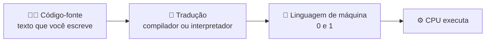

# 1. Como o computador executa um programa

> ⏱️ 10 minutos

## O computador só entende números

Lá no fundo, o processador (a **CPU**) só sabe fazer operações muito simples, como somar dois números, comparar valores e copiar dados de um lugar para outro. E ele só entende essas ordens escritas em **binário**: sequências de 0 e 1.

```
10110000 01100001
```

Isso é **linguagem de máquina**. Funciona, mas ninguém quer programar assim. 😅

## As peças principais

| Peça | Analogia | O que faz |
|---|---|---|
| **CPU** (processador) | O cozinheiro | Executa as instruções, uma de cada vez, bilhões por segundo |
| **Memória RAM** | A bancada da cozinha | Guarda o programa e os dados **enquanto ele roda**. Rápida, mas apaga quando desliga |
| **Armazenamento** (SSD/HD) | A despensa | Guarda os arquivos **para sempre**, mas é mais lento |
| **Entrada e saída** | Pedidos e pratos prontos | Teclado, tela, rede, arquivos |

Quando você abre um programa, ele sai da **despensa** (SSD), vai para a **bancada** (RAM) e o **cozinheiro** (CPU) começa a seguir a receita.

## Código-fonte: a receita escrita por humanos

Programar é escrever uma **receita** que o computador consegue seguir. Como ninguém escreve em binário, usamos **linguagens de programação**, que parecem um pouco com inglês e matemática:

```c
int idade = 20;
if (idade >= 18) {
    printf("Pode tirar a carteira!\n");
}
```

Esse texto se chama **código-fonte**. O problema: a CPU não entende isso. Alguém precisa **traduzir** para linguagem de máquina. Quem faz essa tradução e **quando** ela acontece é justamente a diferença entre linguagens **compiladas** e **interpretadas**, que veremos no [capítulo 3](03-compilada-vs-interpretada.md).



## Variáveis são caixinhas na memória

Quando você escreve `int idade = 20;`, está pedindo: "reserve um espacinho na memória, chame ele de `idade` e guarde o número 20 lá". Todo programa, em qualquer linguagem, é basicamente isso: **guardar dados na memória, transformar esses dados e mostrar o resultado**.

## ✅ Checkpoint

1. Por que não programamos direto em linguagem de máquina?
2. Qual a diferença entre a memória RAM e o SSD?
3. O que é código-fonte?

## 🧠 Desafio sem IA

Abra o Gerenciador de Tarefas (Windows: `Ctrl + Shift + Esc`) ou o Monitor de Atividade (Mac). Encontre quanto de **memória** e de **CPU** o seu navegador está usando. Abra mais 10 abas e veja o que muda.

---

[⬅️ Fundamentos](README.md) · [Próximo: Linguagens de programação ➡️](02-linguagens-de-programacao.md)
