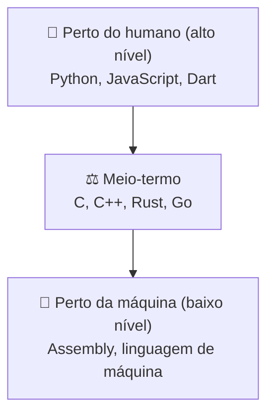

# 2. Linguagens de programação

> ⏱️ 15 minutos

Existem centenas de linguagens. Por quê? Porque cada uma faz **escolhas diferentes**, e cada escolha é boa para um tipo de problema.

## Alto nível × baixo nível

É o quanto a linguagem está "perto" do humano ou da máquina.



| | Alto nível | Baixo nível |
|---|---|---|
| Fácil de ler e escrever | ✅ | ❌ |
| Controle sobre memória e hardware | Pouco | Total |
| Velocidade | Geralmente menor | Geralmente maior |

O **C** fica no meio: é fácil o suficiente para aprender, mas mostra como a memória funciona de verdade. Por isso é tão usado no começo da faculdade.

## Tipagem: como a linguagem trata os tipos de dados

Todo dado tem um **tipo**: número inteiro, número com vírgula, texto, verdadeiro/falso...

### Estática × dinâmica: **quando** o tipo é decidido

| Estática | Dinâmica |
|---|---|
| Você declara o tipo, e ele **não muda** | O tipo é descoberto **enquanto o programa roda** e pode mudar |
| `int idade = 20;` (C, Java, Dart) | `idade = 20` (Python, JavaScript) |
| Erros de tipo aparecem **antes** de rodar | Erros de tipo aparecem **durante** a execução |

### Forte × fraca: o quanto a linguagem **mistura** tipos sozinha

```javascript
// JavaScript (tipagem fraca): mistura sem reclamar
"5" + 1   // "51" (virou texto!)
```

```python
# Python (tipagem forte): recusa misturar
"5" + 1   # TypeError: can only concatenate str (not "int") to str
```

Nenhuma é "melhor": a fraca é mais flexível, a forte evita surpresas.

## Paradigmas: estilos de pensar o programa

| Paradigma | Ideia | Exemplos |
|---|---|---|
| **Estruturado / procedural** | Uma sequência de passos e funções | C |
| **Orientado a objetos** | O programa é feito de "objetos" que têm dados e comportamentos | Java, C#, Dart |
| **Funcional** | Funções que transformam dados, sem mudar estado | Haskell, Elixir |

Muitas linguagens modernas misturam vários paradigmas (Python, JavaScript, Kotlin).

## Onde cada linguagem costuma aparecer

| Área | Linguagens comuns |
|---|---|
| Front-end (sites) | HTML, CSS, JavaScript, TypeScript |
| Back-end (servidores) | Java, C#, Python, JavaScript (Node.js), Go, PHP |
| Mobile | Kotlin, Swift, Dart (Flutter), JavaScript (React Native) |
| Dados e IA | Python, SQL, R |
| Sistemas, jogos, embarcados | C, C++, Rust |

> 💡 **A boa notícia:** os conceitos (variáveis, condições, repetições, funções) são os mesmos em todas. Quem aprende bem a primeira linguagem aprende a segunda muito mais rápido.

## ✅ Checkpoint

1. O C é de alto ou de baixo nível? Por quê?
2. Qual a diferença entre tipagem estática e dinâmica?
3. Cite uma linguagem para mobile e uma para back-end.

## 🧠 Desafio sem IA

Pesquise qual linguagem é usada no app que você mais usa no celular. Ela é compilada ou interpretada? (Você vai entender essa pergunta no próximo capítulo.)

---

[⬅️ Como o computador executa](01-como-o-computador-executa-um-programa.md) · [Próximo: Compilada ou interpretada? ➡️](03-compilada-vs-interpretada.md)
