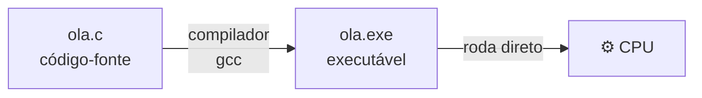
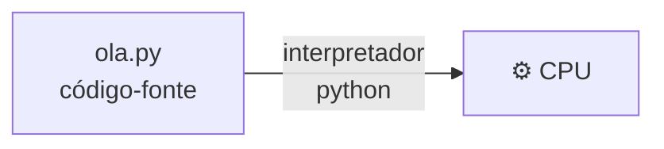
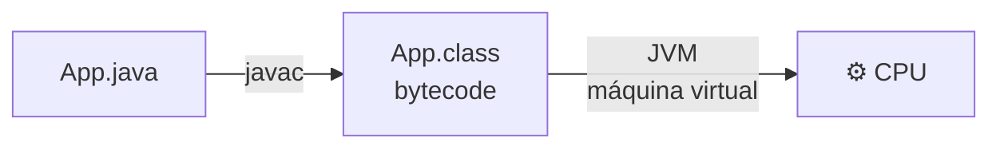

# 3. Compilada ou interpretada?

> ⏱️ 15 minutos

Lembra que a CPU só entende linguagem de máquina? Toda linguagem precisa de um **tradutor**. A diferença está em **como** e **quando** essa tradução acontece.

## A analogia do livro

Imagine um livro em inglês para um leitor que só fala português:

- **Compilação:** um tradutor traduz o **livro inteiro antes**. O leitor recebe um livro novo, todo em português, e lê rapidinho quantas vezes quiser.
- **Interpretação:** um intérprete fica **ao lado do leitor**, traduzindo frase por frase **enquanto** ele lê. Não precisa esperar a tradução do livro todo, mas a leitura é mais lenta, e o intérprete precisa estar sempre junto.

## Linguagens compiladas

Um programa chamado **compilador** lê **todo** o código-fonte e gera um **executável**: um arquivo em linguagem de máquina que roda sozinho.



```bash
gcc ola.c -o ola    # 1. compila (uma vez)
./ola               # 2. executa (quantas vezes quiser)
```

- ✅ Executa muito rápido
- ✅ Erros de sintaxe e de tipo aparecem **antes** de rodar
- ✅ Quem usa o programa não precisa ter o compilador
- ❌ Precisa compilar de novo a cada mudança
- ❌ O executável é específico para um sistema (um `.exe` de Windows não roda no Mac)

**Exemplos:** C, C++, Rust, Go

## Linguagens interpretadas

Um programa chamado **interpretador** lê o código-fonte e executa **linha por linha**, na hora.



```bash
python ola.py       # lê e executa na hora
```

- ✅ Muda e roda na hora, sem etapa de compilação
- ✅ O mesmo código roda em qualquer sistema que tenha o interpretador
- ❌ Geralmente mais lenta
- ❌ Alguns erros só aparecem quando o programa chega naquela linha
- ❌ Quem for usar precisa ter o interpretador instalado

**Exemplos:** Python, JavaScript, PHP, Ruby

## O meio-termo: bytecode e máquina virtual

Muitas linguagens modernas fazem os dois: **compilam** para um código intermediário (o **bytecode**) e depois uma **máquina virtual** executa esse bytecode, muitas vezes compilando os trechos mais usados na hora (**JIT**, *just-in-time*).



**Exemplos:** Java e Kotlin (JVM), C# (.NET), Dart, e até o Python (que gera arquivos `.pyc` por trás).

> 💡 Na verdade, "compilada" e "interpretada" é uma característica da **implementação**, não da linguagem em si. Existe interpretador de C e compilador de Python. Mas, no dia a dia, falamos do jeito **mais comum** de usar cada uma.

## Resumo

| | Compilada | Interpretada | Bytecode + VM |
|---|---|---|---|
| Tradução | Antes, tudo de uma vez | Durante, linha por linha | Antes (parcial) + durante |
| Velocidade | 🚀🚀🚀 | 🚀 | 🚀🚀 |
| Gera executável | Sim | Não | Gera bytecode |
| Exemplos | C, C++, Rust, Go | Python, JavaScript, PHP | Java, Kotlin, C#, Dart |

## E o que isso muda para "instalar uma linguagem"?

| Tipo | O que você instala | Exemplo |
|---|---|---|
| Compilada | Um **compilador** | `gcc` para C |
| Interpretada | Um **interpretador** | `python` para Python, `node` para JavaScript |
| Bytecode + VM | Um **kit de desenvolvimento** (compilador + VM) | JDK para Java |

## ✅ Checkpoint

1. Qual a diferença entre compilador e interpretador?
2. Por que um `.exe` feito no Windows não roda no Mac?
3. O que é bytecode?

## 🧠 Desafio sem IA

Na pasta [`linguagens/c/`](../linguagens/c/), instale o compilador e compile o "Olá, mundo". Depois, ache o arquivo executável gerado na pasta e abra ele num editor de texto. O que aparece? Por quê?

---

[⬅️ Linguagens de programação](02-linguagens-de-programacao.md) · [Próximo: Sintaxe e semântica ➡️](04-sintaxe-e-semantica.md)
