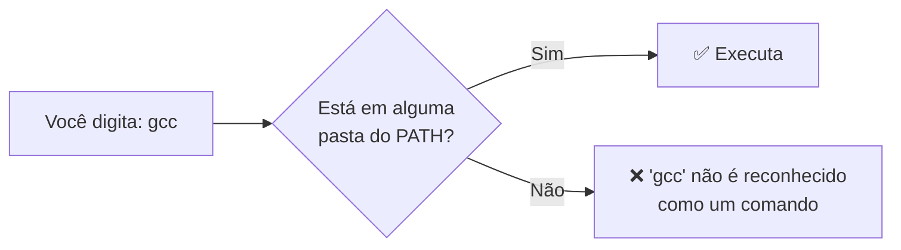

# 5. Seu ambiente de programação

> ⏱️ 10 minutos

## Editor × IDE

| | Editor de código | IDE (Ambiente de Desenvolvimento Integrado) |
|---|---|---|
| O que é | Um editor de texto turbinado | Um "pacote completo": editor + compilador + depurador + ferramentas |
| Exemplos | **VS Code**, Sublime, Notepad++ | Visual Studio, IntelliJ, Android Studio, Code::Blocks |
| Peso | Leve | Mais pesado |

Recomendamos o **VS Code**: gratuito, leve e com extensões para praticamente todas as linguagens. Baixe em **https://code.visualstudio.com**.

> 💡 O VS Code **não** vem com compiladores. Ele é o lugar onde você **escreve**; quem **roda** o código é o compilador ou interpretador que você instala à parte.

## O terminal

O terminal é uma janela onde você conversa com o computador por texto. É por ele que você compila, executa e usa o Git.

| Sistema | Terminal |
|---|---|
| Windows | **PowerShell** (ou o terminal integrado do VS Code) |
| Mac | **Terminal** |

No VS Code, abra o terminal integrado com `` Ctrl + ` `` (a crase, perto do Esc).

Comandos básicos (os mesmos do [comece-por-aqui](https://github.com/Unidunedev/comece-por-aqui/blob/main/04-primeiros-comandos.md)):

| Comando | O que faz |
|---|---|
| `pwd` | Mostra em qual pasta você está |
| `ls` | Lista os arquivos |
| `cd pasta` | Entra numa pasta (`cd ..` volta uma) |

## O que significa "instalar uma linguagem"?

Na prática, é instalar o **programa tradutor** dela (compilador ou interpretador) e deixá-lo acessível no terminal.

## O PATH

Quando você digita `gcc` ou `python` no terminal, como o computador sabe onde esse programa está? Ele procura numa lista de pastas chamada **PATH** (caminho).



É por isso que, depois de instalar uma linguagem, às vezes é preciso:

1. **Fechar e abrir o terminal** (ele só lê o PATH quando abre).
2. Ou **adicionar a pasta da instalação ao PATH** manualmente. Os guias de instalação de cada pasta explicam quando isso é necessário.

Para conferir se algo está instalado e no PATH, quase todo programa aceita a opção `--version`:

```bash
gcc --version
python --version
git --version
```

## Extensões úteis do VS Code

| Extensão | Para quê |
|---|---|
| **C/C++** (Microsoft) | Destaque de sintaxe, autocompletar e depuração em C |
| **Python** (Microsoft) | O mesmo para Python |
| **Portuguese (Brazil) Language Pack** | VS Code em português |
| **Error Lens** | Mostra os erros na própria linha do código |

## ✅ Checkpoint

1. Qual a diferença entre o VS Code e o compilador?
2. O que significa a mensagem "`gcc` não é reconhecido como um comando"?

## 🧠 Desafio sem IA

Descubra quais pastas estão no seu PATH.
- Windows (PowerShell): `$env:Path -split ';'`
- Mac: `echo $PATH | tr ':' '\n'`

Você reconhece alguma delas?

---

[⬅️ Sintaxe e semântica](04-sintaxe-e-semantica.md) · [Fundamentos 🧱](README.md) · [Começar por Lógica ➡️](../disciplinas/logica/) · [Começar por C ➡️](../linguagens/c/) · [Python ➡️](../linguagens/python/) · [Java ➡️](../linguagens/java/)
