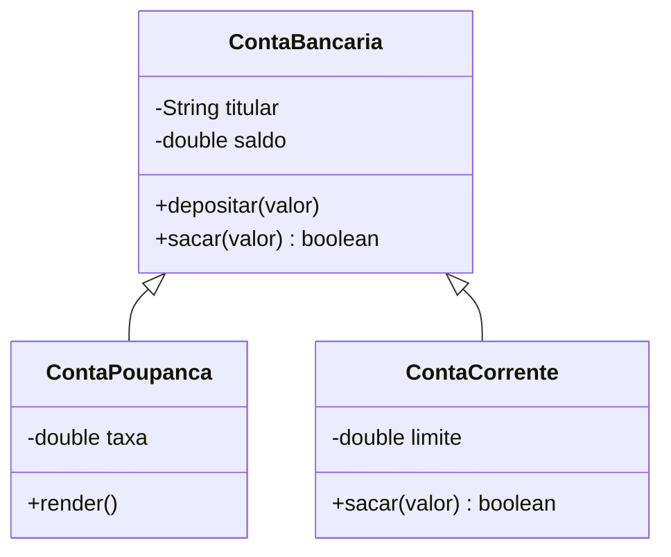

# 06 · Herança, polimorfismo e interfaces

> Pré-requisito: [classes e objetos](05-classes-e-objetos.md)

## Herança: `extends`

Uma conta poupança **é uma** conta bancária, com algo a mais:

```java
public class ContaPoupanca extends ContaBancaria {
    private double taxa;

    public ContaPoupanca(String titular, double taxa) {
        super(titular);              // chama o construtor da classe mãe
        this.taxa = taxa;
    }

    public void render() {
        depositar(getSaldo() * taxa);
    }
}
```



- `extends` = "herda de". Em Java, uma classe herda de **uma só** classe.
- `super(...)` chama o construtor da mãe (precisa ser a primeira linha).
- A filha herda os métodos `public` e `protected`, mas **não** acessa os atributos `private` da mãe diretamente: usa os getters e métodos.

> 💡 Todas as classes Java herdam, no fim das contas, de `Object`. É de lá que vêm o `toString()` e o `equals()`.

## Sobrescrita e polimorfismo

```java
public class ContaCorrente extends ContaBancaria {
    private double limite;

    public ContaCorrente(String titular, double limite) {
        super(titular);
        this.limite = limite;
    }

    @Override
    public boolean sacar(double valor) {
        // regra diferente: pode usar o limite
        ...
    }
}
```

Agora o mesmo código funciona para todos os tipos de conta:

```java
ContaBancaria[] contas = {
    new ContaBancaria("Ana"),
    new ContaCorrente("Bia", 500)
};
for (ContaBancaria c : contas) {
    System.out.println(c.sacar(100));   // false para a Ana, true para a Bia
}
```

A variável é do tipo `ContaBancaria`, mas o Java chama o `sacar` **do objeto real**. Isso é **polimorfismo**.

## Classes abstratas: o molde incompleto

Às vezes a classe mãe não faz sentido sozinha. Não existe "um animal genérico": existe cachorro, gato...

```java
public abstract class Animal {
    public abstract String falar();      // sem corpo: cada filha implementa
}

public class Cachorro extends Animal {
    @Override
    public String falar() { return "Au au"; }
}
```

`new Animal()` dá erro: classe abstrata não pode virar objeto.

## Interfaces: um contrato

Uma **interface** diz **o que** uma classe sabe fazer, sem dizer **como**:

```java
public interface Tributavel {
    double calcularImposto();
}

public class ContaCorrente extends ContaBancaria implements Tributavel {
    @Override
    public double calcularImposto() {
        return getSaldo() * 0.01;
    }
}
```

- Uma classe herda de **uma** classe, mas pode implementar **várias** interfaces.
- Pense na interface como uma tomada: qualquer aparelho com o plugue certo funciona nela.

## Os quatro pilares no Java

| Pilar | Recurso do Java |
|---|---|
| **Abstração** | Classes, classes abstratas e interfaces |
| **Encapsulamento** | `private` + getters e métodos com regras |
| **Herança** | `extends` e `super` |
| **Polimorfismo** | `@Override` + variáveis do tipo da mãe |

> 💡 **O que o mercado valoriza:** frameworks como o **Spring** são cheios de interfaces. Entender "programar para uma interface, não para uma implementação" é o que diferencia quem sabe Java de quem só escreve Java.

## 🧪 Teste rápido

1. Qual a diferença entre classe abstrata e interface?
2. O que o `@Override` indica?
3. Crie `Animal` (abstrata), `Cachorro` e `Gato`, coloque num array e chame `falar()` em todos.

---

[⬅️ Classes e objetos](05-classes-e-objetos.md) · [Próximo: Coleções ➡️](07-colecoes.md)
