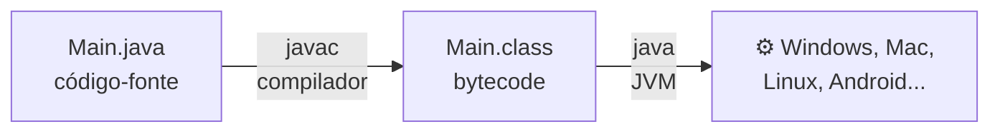

# ☕ Sobre o Java

> Leitura rápida para entender **o que é**, **onde se usa** e **o que os cursos raramente contam**.

## Em uma frase

Java é uma linguagem **compilada para bytecode** e executada por uma **máquina virtual (a JVM)**, com **tipagem estática e forte** e totalmente pensada para **orientação a objetos**. É uma das linguagens mais usadas em **empresas, bancos e sistemas grandes**.

## Um pouco de história

- Criada por **James Gosling** e equipe na Sun Microsystems, lançada em **1995**. Hoje pertence à **Oracle**.
- O nome original era **Oak** (carvalho, a árvore na janela do Gosling). Mudou para Java por causa do café da ilha de Java, por isso o logo é uma **xícara de café** ☕. Combina com a gente!
- O slogan era **"Write once, run anywhere"**: escreva uma vez, rode em qualquer lugar.
- **Java não tem nada a ver com JavaScript.** O nome do JavaScript foi uma jogada de marketing de 1995 para pegar carona na fama do Java. São linguagens totalmente diferentes. ("Java está para JavaScript assim como carro está para carpete.")

## Como o Java roda

1. O **`javac`** compila o `.java` para **bytecode** (`.class`), que não é específico de nenhum sistema.
2. A **JVM** (Java Virtual Machine) executa esse bytecode. Cada sistema tem a sua JVM, por isso o mesmo `.class` roda em todos.
3. A JVM ainda compila na hora os trechos mais usados para código de máquina (**JIT**). Por isso o Java fica rápido depois que "esquenta".

Veja mais em [compilada ou interpretada?](../../fundamentos/03-compilada-vs-interpretada.md).

### JDK, JRE e JVM: a sopa de letrinhas

| Sigla | É | Você precisa para... |
|---|---|---|
| **JVM** | A máquina virtual que executa o bytecode | Rodar |
| **JRE** | JVM + bibliotecas padrão | Rodar programas Java |
| **JDK** | JRE + compilador (`javac`) + ferramentas | **Programar** em Java ← é o que você instala |

## Onde o Java é mais usado

| Área | Para quê | Ferramentas famosas |
|---|---|---|
| **Back-end corporativo** | Sistemas de bancos, e-commerce, governo | **Spring Boot**, Quarkus, Jakarta EE |
| **Android** | Apps de celular | Android SDK (hoje o Kotlin é o preferido, mas roda na mesma base) |
| **Big Data** | Processar volumes gigantes de dados | Hadoop, Kafka, Spark (em parte) |
| **Jogos** | O Minecraft (versão Java) é o exemplo mais famoso | LibGDX |
| **Ferramentas de dev** | IDEs como IntelliJ e Android Studio são feitas em Java | |

### Trilhas onde ele aparece

| Trilha | Peso do Java |
|---|---|
| Back-end | ⭐⭐⭐ Uma das principais, muito pedida no mercado brasileiro |
| Mobile (Android) | ⭐⭐ Base do Android, junto com Kotlin |
| Dados | ⭐ Em ferramentas de big data |
| Front-end | Praticamente não se usa |

### A família da JVM

Outras linguagens também rodam na JVM e conversam com o Java: **Kotlin** (a favorita para Android), **Scala** e **Groovy**. Aprender Java abre a porta para todas elas.

## O que os cursos raramente contam

1. **Java é "verboso", e isso tem motivo.** Ele obriga a declarar tipos e escrever bastante. É chato no começo, mas em sistemas com milhões de linhas e centenas de devs, essa clareza evita muitos erros.
2. **Desde o Java 11, dá para rodar sem compilar antes:** `java Main.java`. Ótimo para estudar. Os nossos desafios usam esse modo.
3. **Use versões LTS.** As versões com suporte longo (*Long Term Support*) são as que as empresas usam: **17, 21, 25**. Prefira a LTS mais recente.
4. **`==` não compara textos!** Em Java, `"a" == "a"` às vezes dá `true` e às vezes `false`. Use sempre `.equals()`. Explicamos em [arrays e strings](material/03-arrays-e-strings.md).
5. **O Brasil e a vírgula.** Num computador configurado em português, o Java pode imprimir `7,50` em vez de `7.50`, e o `Scanner` pode esperar vírgula ao ler números. Isso quebra programas e testes. Veja em [tipos e variáveis](material/02-tipos-e-variaveis.md#a-pegadinha-brasileira-vírgula-ou-ponto).
6. **O Java moderno é bem menos chato.** Versões recentes trouxeram `var` (o tipo é deduzido), `record` (classes de dados em uma linha) e, a partir do Java 25, até um `main` simplificado. Muitos tutoriais antigos não mostram isso.

## Ecossistema

| | |
|---|---|
| **Gerenciadores de projeto** | **Maven** (`pom.xml`) e **Gradle** (`build.gradle`) |
| **Repositório de bibliotecas** | Maven Central |
| **Testes** | JUnit |
| **IDEs mais usadas** | IntelliJ IDEA, VS Code (com o *Extension Pack for Java*), Eclipse |
| **Documentação oficial** | https://dev.java |

---

[⬅️ Java](README.md)
