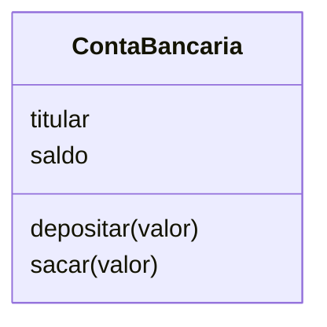

# 05 · Classes e objetos

> ⏱️ 30 minutos · Aqui começa a **Programação Orientada a Objetos (POO)**.

## O problema

Imagine um sistema de banco com várias contas. Cada conta tem titular, saldo, e pode receber depósitos e saques. Com o que vimos até agora, você teria variáveis soltas e funções soltas:

```python
titular_1 = "Ana"
saldo_1 = 100
titular_2 = "Caio"
saldo_2 = 50

def depositar(saldo, valor): ...
```

Com 1000 contas, vira o caos. A **orientação a objetos** junta os **dados** e as **ações** de uma coisa num lugar só.

## Classe × objeto: a forma e o bolo

- **Classe** é a **forma de bolo**: o molde, a descrição de como algo é.
- **Objeto** é o **bolo**: uma coisa de verdade, criada a partir do molde.

Com uma forma, você faz quantos bolos quiser, e cada um pode ter cobertura diferente.



| Conceito | No banco | No código |
|---|---|---|
| Classe | "O que é uma conta" | `class ContaBancaria` |
| Objeto | A conta da Ana | `conta_ana = ContaBancaria("Ana")` |
| Atributo | O saldo da conta | `self.saldo` |
| Método | Depositar | `def depositar(self, valor)` |

## Criando a primeira classe

```python
class ContaBancaria:
    def __init__(self, titular, saldo=0):
        self.titular = titular
        self.saldo = saldo

    def depositar(self, valor):
        self.saldo += valor

    def sacar(self, valor):
        if valor > self.saldo:
            return False
        self.saldo -= valor
        return True


conta_ana = ContaBancaria("Ana", 100)
conta_caio = ContaBancaria("Caio")

conta_ana.depositar(50)
print(conta_ana.saldo)     # 150
print(conta_caio.saldo)    # 0: cada objeto tem o seu próprio saldo
```

## Entendendo as peças

### `__init__`: o construtor

É o método que roda **automaticamente** quando o objeto é criado. Serve para dar os valores iniciais. `ContaBancaria("Ana", 100)` chama o `__init__` com `titular="Ana"` e `saldo=100`.

### `self`: "eu mesmo"

O `self` é o próprio objeto. Quando você escreve `conta_ana.depositar(50)`, o Python transforma em `ContaBancaria.depositar(conta_ana, 50)`. Dentro do método, `self` é a `conta_ana`. Por isso `self.saldo` mexe no saldo **daquela** conta, e não das outras.

> ⚠️ Esquecer o `self` como primeiro parâmetro dos métodos é o erro mais comum de iniciante: `TypeError: depositar() takes 1 positional argument but 2 were given`.

### Atributos e métodos

- **Atributos** (`self.titular`, `self.saldo`) são os **dados** do objeto.
- **Métodos** (`depositar`, `sacar`) são as **ações**: funções que pertencem à classe.

## Mostrando um objeto bonito: `__str__`

```python
print(conta_ana)   # <__main__.ContaBancaria object at 0x7f...>  😕
```

Ensine o Python a mostrar seu objeto:

```python
class ContaBancaria:
    # ... __init__ e os outros métodos ...

    def __str__(self):
        return f"{self.titular}: R$ {self.saldo:.2f}"

print(conta_ana)   # Ana: R$ 150.00
```

Métodos com dois sublinhados dos dois lados (`__init__`, `__str__`) são chamados de **métodos mágicos** (ou *dunder*). O Python chama eles automaticamente em situações especiais.

## Objetos numa lista

```python
contas = [ContaBancaria("Ana", 100), ContaBancaria("Bia", 300), ContaBancaria("Caio", 50)]
total = sum(conta.saldo for conta in contas)
mais_rica = max(contas, key=lambda c: c.saldo)
print(mais_rica)   # Bia: R$ 300.00
```

## Por que isso importa?

Quase tudo no Python já é objeto. Quando você faz `"oi".upper()` ou `lista.append(3)`, está chamando **métodos** de objetos da classe `str` e da classe `list`. Agora você sabe criar os seus.

E os frameworks que você vai usar no mercado (Django, FastAPI) são cheios de classes: cada tabela do banco de dados vira uma classe, cada linha vira um objeto.

## 🧪 Teste rápido

1. Qual a diferença entre classe e objeto?
2. Para que serve o `self`?
3. Crie uma classe `Aluno` com `nome` e uma lista de `notas`, e um método `media()`.

## 🎯 Pratique

- [03 · Conta bancária](../desafios/03-conta-bancaria/)

---

[⬅️ Funções](04-funcoes.md) · [Próximo: Herança e encapsulamento ➡️](06-heranca-e-encapsulamento.md)
