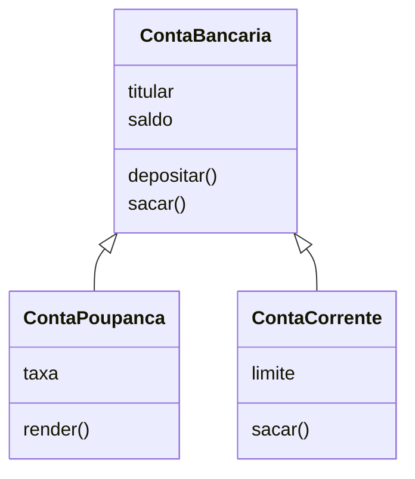

# 06 · Herança, encapsulamento e polimorfismo

> Pré-requisito: [classes e objetos](05-classes-e-objetos.md)

Os três pilares da orientação a objetos (junto com a **abstração**, que é justamente modelar o mundo em classes, como você já fez).

## Encapsulamento: proteger os dados

Na nossa conta, qualquer um pode fazer isto:

```python
conta.saldo = 1_000_000    # 🤑 sem depósito nenhum!
```

**Encapsular** é esconder os detalhes internos e só permitir mudanças pelos métodos certos.

```python
class ContaBancaria:
    def __init__(self, titular):
        self.titular = titular
        self._saldo = 0          # o "_" avisa: não mexa direto!

    @property
    def saldo(self):             # permite LER conta.saldo
        return self._saldo

    def depositar(self, valor):
        if valor <= 0:
            raise ValueError("O deposito precisa ser positivo")
        self._saldo += valor
```

```python
conta.saldo          # ✅ dá para ler
conta.saldo = 50     # ❌ AttributeError: não dá para alterar direto
conta.depositar(50)  # ✅ o único caminho, e ele valida o valor
```

> 💡 **Coisa que poucos contam:** o Python não tem `private` de verdade, como o Java. O `_` no começo do nome é um **combinado** entre programadores: "isso é interno, não use de fora". O Python confia que você vai respeitar. A frase da comunidade é: *"somos todos adultos aqui"*.

## Herança: reaproveitar uma classe

Uma **conta poupança** é uma conta bancária, com algo a mais: ela rende juros. Em vez de copiar tudo, ela **herda** da conta:

```python
class ContaPoupanca(ContaBancaria):          # herda de ContaBancaria
    def __init__(self, titular, taxa):
        super().__init__(titular)            # chama o __init__ da classe "mãe"
        self.taxa = taxa

    def render(self):
        self._saldo += self._saldo * self.taxa


poupanca = ContaPoupanca("Ana", 0.01)
poupanca.depositar(100)    # método herdado de ContaBancaria
poupanca.render()          # método novo
print(poupanca.saldo)      # 101.0
```



- `ContaBancaria` é a classe **mãe** (ou base, ou superclasse).
- `ContaPoupanca` é a classe **filha** (ou derivada, ou subclasse).
- `super()` acessa a classe mãe.

> 💡 Teste para saber se herança faz sentido: "uma ContaPoupanca **é uma** ContaBancaria?" Sim. "Um Cliente **é uma** ContaBancaria?" Não: o cliente **tem** uma conta. Nesse caso, não use herança: coloque a conta como atributo do cliente.

## Polimorfismo: o mesmo comando, comportamentos diferentes

A conta corrente permite sacar além do saldo, até um limite. Ela **sobrescreve** o método `sacar`:

```python
class ContaCorrente(ContaBancaria):
    def __init__(self, titular, limite):
        super().__init__(titular)
        self.limite = limite

    def sacar(self, valor):                  # mesma assinatura, regra diferente
        if valor > self._saldo + self.limite:
            return False
        self._saldo -= valor
        return True
```

Agora o mesmo código funciona para qualquer tipo de conta, e cada uma reage do seu jeito:

```python
contas = [ContaBancaria("Ana"), ContaCorrente("Bia", limite=500)]
for conta in contas:
    print(conta.sacar(100))   # False para a Ana (sem saldo), True para a Bia (tem limite)
```

**Polimorfismo** ("muitas formas") é isso: você chama `sacar()` sem se preocupar com o tipo exato da conta.

## Resumo dos pilares

| Pilar | Em uma frase | No exemplo |
|---|---|---|
| **Abstração** | Representar o mundo real em classes | `ContaBancaria` |
| **Encapsulamento** | Proteger os dados e expor só o necessário | `_saldo` + `depositar()` |
| **Herança** | Reaproveitar uma classe, adicionando ou mudando coisas | `ContaPoupanca(ContaBancaria)` |
| **Polimorfismo** | O mesmo método se comporta diferente em cada classe | `sacar()` na conta corrente |

## 🧪 Teste rápido

1. "Gato é um Animal" ou "Gato tem um Animal"? E "Carro e Motor"?
2. Por que proteger o `saldo` com `_` e `@property`?
3. Crie as classes `Animal` (com o método `falar()`), `Cachorro` e `Gato`, cada um falando diferente. Coloque todos numa lista e chame `falar()` num `for`.

---

[⬅️ Classes e objetos](05-classes-e-objetos.md) · [Próximo: Módulos e pacotes ➡️](07-modulos-e-pacotes.md)
